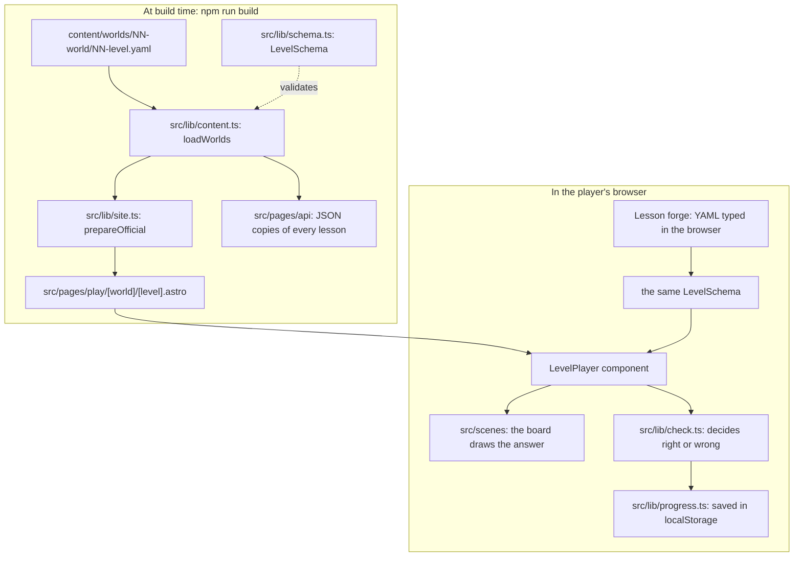

# Repository map

A guide to where everything is in Hephaestus Bot and what a change will touch. It is
written for contributors and for coding agents working on the project: read it before
changing code, and update it in the same pull request when you add, move or remove a
file, a board, a route or a world. `tests/repo-map.test.ts` fails when it falls behind
(see [Keeping this map current](#keeping-this-map-current)).

Last checked against: `main` at commit `5b740c2`, 17 November 2026.

## At a glance

- **What it is:** a static website built with Astro. Lessons are YAML data files.
  Interactive parts are Preact components that run in the browser. There is no
  backend, no database and no API key; progress is kept in the player's browser.
- **Levels:** 48 in 7 worlds
- **Boards:** 9
- **Live site:** <https://ltvms-hephaestus-dev.github.io/Hephaestus-Bot/>, deployed from
  `main` by GitHub Actions.

| Command | What it does |
|---|---|
| `npm install` | Install dependencies (Node.js 22.12 or newer) |
| `npm run dev` | Local site at `http://localhost:4321/Hephaestus-Bot/` |
| `npm test` | All tests, including proof that every level can be solved |
| `npm run build` | Static site in `dist/` |
| `npm run preview` | Serve the built `dist/` locally |
| `npm run new:level -- <world-folder> <lesson-id>` | Create the next numbered lesson file |

Top-level folders:

| Folder | Holds |
|---|---|
| `content/` | All lesson data. The only place lessons live |
| `src/` | The engine: lesson format, answer checker, boards, components, pages |
| `tests/` | The gates CI runs before every deploy |
| `public/` | Files served as they are: logo and icons |
| `scripts/` | Command-line helpers |
| `docs/` | Decisions, the original build prompt, prompts used to delegate work |
| `.github/workflows/` | Deploy and link-check automation |

## How a level gets from a file to the screen

1. **Build.** `loadWorlds` reads every world folder in number order, validates each file
   with `LevelSchema`, and stops the build with a readable message if any lesson is
   invalid. `prepareOfficial` renders the lesson Markdown, fills in `{{fact.key}}`
   values from `content/facts.yaml`, and works out the previous and next level.
2. **Page.** Each level becomes a static page that hands the prepared level to
   `LevelPlayer`, which runs in the browser.
3. **Play.** As the player types or clicks, `LevelPlayer` passes the answer to the
   board, which redraws. Pressing **Check answer** calls `check()`, the only code that
   decides whether an answer is right. A solved level is recorded in `localStorage`.
4. **Forge.** The lesson forge validates text typed in the browser with the same schema
   and plays it with the same `LevelPlayer`, so a lesson behaves the same in the forge
   as in the game.

## Rules the code depends on

These hold everywhere. A change that breaks one needs a decision recorded in
`docs/DECISIONS.md`, not just a code review.

1. **A level is data.** Adding a level or a world needs no code. Only a new kind of
   board needs code.
2. **Correctness is decided in one place:** `check()` in `src/lib/check.ts`. It is pure:
   no DOM, no network, no model. Boards show what an answer means and never judge it.
3. **One definition of the lesson format:** `src/lib/schema.ts`. The build, the tests,
   the forge and `/api/schema.json` all use it. Unknown keys are errors, so typos are
   caught rather than ignored.
4. **Boards and lessons must agree.** When a board's data decides the answer (a
   probability, a token count, a price), a test in `tests/content.test.ts` proves the
   board and the reference solution match.
5. **Every internal link goes through `url()`** in `src/lib/url.ts`, because the site is
   served under `/Hephaestus-Bot/`, not at the domain root.
6. **Text from outside is untrusted.** Lessons imported into the forge are sanitised
   with DOMPurify before rendering, and the schema only accepts `https` links.
7. **Nothing leaves the browser.** No backend, no API keys, no analytics, no
   third-party requests when a page loads. Fonts are self-hosted.
8. **Facts that go out of date** (MCP revision, tokenizer name) live in
   `content/facts.yaml`, not inside lesson text.

## Where to change things

| To change... | Edit | Then run |
|---|---|---|
| A lesson's text, challenge, hints or links | its file in `content/worlds/` | `npm test` |
| The order of levels in a world | the number prefix of the file names (the `id` must equal the file name without the prefix) | `npm test` |
| A world's title, order, question or robot part | its `world.yaml` | `npm test` |
| The lesson format | `src/lib/schema.ts`, then `src/lib/templates.ts` and `CONTRIBUTING.md` | `npm test` |
| What counts as a right answer | `src/lib/check.ts` | `npm test` |
| How a board looks or behaves | `src/scenes/index.tsx` and the board section of `src/styles/global.css` | `npm test`, then play it in `npm run dev` |
| World colours | `src/lib/temper.ts` | look at the home page |
| The robot drawing | `src/components/Robot.tsx` | look at any level |
| Site name, repository, branch used by forge links | `src/config.ts` | `npm run build` |
| Site address or base path | `astro.config.mjs`, or the `SITE_URL` and `BASE_PATH` variables at build time | `npm run build` |
| Header, navigation, footer, page icons | `src/layouts/Layout.astro` | `npm run build` |
| Any styling | `src/styles/global.css` | look at the page |
| The MCP revision or tokenizer named in lessons | `content/facts.yaml` | `npm test` |
| The "Beyond the game" links | `content/beyond.yaml` | `npm test` |
| Starter lessons in the forge | `src/lib/templates.ts` | `npm test` (templates are tested) |
| The logo | the images in `public/` | `npm run build` |

## Lesson data: `content/`

| Path | What it is |
|---|---|
| `content/beyond.yaml` | Sections, topics and links for the "Beyond the game" page |
| `content/facts.yaml` | Version-sensitive facts, used in lessons as `{{fact.key}}`, with a `last_verified` date |

One folder per world. Each holds a `world.yaml` and one file per level named
`NN-<level-id>.yaml`; the number sets the play order.

| Folder | URL id | Title | Robot part | Levels | Boards used |
|---|---|---|---|---|---|
| `content/worlds/01-brain/` | `brain` | How LLMs work | Brain | 7 | bars, tokens, embeddings, attention, context |
| `content/worlds/02-voice/` | `voice` | LLMs from code | Voice | 7 | messages |
| `content/worlds/03-memory-and-hands/` | `memory-and-hands` | Knowledge and tools | Memory and hands | 7 | messages, retrieval |
| `content/worlds/04-universal-plug/` | `universal-plug` | Model Context Protocol | Universal plug | 7 | messages, robot |
| `content/worlds/05-autonomy/` | `autonomy` | Agents | Autonomy | 7 | messages, loop, robot |
| `content/worlds/06-street-smarts/` | `street-smarts` | Agentic systems in production | Street smarts | 6 | messages, robot |
| `content/worlds/07-graduation/` | `graduation` | Capstone: real code | Graduation | 7 | messages, robot |

The full lesson format, with every field and challenge type, is in `CONTRIBUTING.md`.

## Engine: `src/lib/`

| Path | What it does | Main exports |
|---|---|---|
| `src/lib/schema.ts` | The lesson format, as Zod schemas. Also checks things one field cannot: blanks match in both languages, a choice has a correct option, ids are unique | `LevelSchema`, `WorldSchema`, `PackSchema`, `BeyondSchema`, `explain` |
| `src/lib/check.ts` | Decides whether an answer is right, for all four challenge types | `check`, `checkBlank`, `referenceAnswer`, `normalize`, `getPath` |
| `src/lib/content.ts` | Reads `content/` at build time; nothing else touches the disk. Builds the topic-map trees | `loadWorlds`, `loadBeyond`, `loadFacts`, `topicTree`, `worldTree` |
| `src/lib/site.ts` | Turns loaded worlds into what pages need: links, the level list, a prepared level with previous and next | `prepareOfficial`, `allLevels`, `levelHref`, `worldHref`, `fullId` |
| `src/lib/prepare.ts` | The shape `LevelPlayer` receives, whether the level came from the build or the forge | `prepare`, type `Prepared` |
| `src/lib/markdown.ts` | Markdown to HTML. Links open in a new tab; non-web links are neutralised | `renderMd`, `withFacts` |
| `src/lib/progress.ts` | Reads and writes browser storage, guarded so the game still plays when storage is blocked | `readStore`, `writeStore`, `markSolved`, `readMyLessons`, `writeMyLessons` |
| `src/lib/tokenizer.ts` | The real `o200k_base` tokenizer, loaded only when a level needs it (the file is large) | `tokenize`, `countTokens` |
| `src/lib/highlight.ts` | A small syntax highlighter for Python and TypeScript that keeps answer blanks intact | `highlight` |
| `src/lib/temper.ts` | The seven world colours (steel temper colours), repeating from world 8 | `TEMPER`, `temper`, `temperStyle` |
| `src/lib/templates.ts` | The forge's starter lessons, one per challenge type | `TEMPLATES` |
| `src/lib/url.ts` | Adds the site's base path to internal links | `url` |
| `src/config.ts` | Site name, GitHub repository and branch, code languages | `SITE`, `LANGS` |

## Boards: `src/scenes/index.tsx`

All boards live in `src/scenes/index.tsx` and are registered in `SCENES`. A lesson picks
one with `scene: type:`. Boards read the player's answer by name: each blank by its own
name, and the other challenge types as `choice`, `order` and `json` (mapped in
`src/components/LevelPlayer.tsx`). Logic that decides what a board draws is in pure,
exported functions so the tests can call it.

| Board | Shows | Tested helper | Used in worlds |
|---|---|---|---|
| `robot` | Only the robot and its speech bubble | none | 4, 5, 6, 7 |
| `bars` | Next-token probabilities, temperature, top-p and sample answers | `reshape` | 1 |
| `tokens` | Live tokenization of what the player types | uses `src/lib/tokenizer.ts` | 1 |
| `embeddings` | Words on a 2D map, with vector arithmetic | `analogy` | 1 |
| `attention` | A sentence with attention arcs, hidden until solved | none | 1 |
| `context` | A conversation against a context-window size | `fitWindow` | 1 |
| `messages` | A request and the reply or error, with outcomes described as data (`cases`). Also draws traces and protocol exchanges | `resolveMessages`, `bill`, `streamTiming` | 2 to 7 |
| `retrieval` | Stored passages ranked by similarity to a question | `topK` | 3 |
| `loop` | An agent loop step by step, and where it stops | `runLoop` | 5 |

The options each board accepts are documented in `CONTRIBUTING.md` under "Scenes".

## Components: `src/components/`

| Path | What it does |
|---|---|
| `src/components/LevelPlayer.tsx` | Plays one prepared level: lesson, task (fill, choice, order or JSON), hints, feedback, links, board and robot. `persist={false}` stops forge previews counting as progress |
| `src/components/Robot.tsx` | The robot as SVG. It gains one part per world and has idle, happy and sad moods |
| `src/components/TopicMap.tsx` | The zoomable topic map (markmap), loaded lazily after the fonts so labels are measured correctly |
| `src/components/MapList.astro` | The same topic tree as nested lists, for readers without JavaScript and for screen readers |
| `src/components/Forge.tsx` | The lesson forge: templates, live validation and preview, save, download, import from a file or URL, and a prefilled "propose on GitHub" link |
| `src/components/CustomPlay.tsx` | Plays a lesson saved in the browser by the forge |

## Pages and routes: `src/pages/` and `src/layouts/`

Every URL below sits under the base path `/Hephaestus-Bot/`.

| URL | Source | Built |
|---|---|---|
| `/` | `src/pages/index.astro` | 1 |
| `/worlds/<world>/` | `src/pages/worlds/[world].astro` | one per world |
| `/play/<world>/<level>/` | `src/pages/play/[world]/[level].astro` | one per level |
| `/map/` | `src/pages/map.astro` | 1 |
| `/beyond/` | `src/pages/beyond.astro` | 1 |
| `/forge/` | `src/pages/forge/index.astro` | 1 |
| `/forge/play/?id=<lesson-id>` | `src/pages/forge/play.astro` | 1 |
| any unknown address | `src/pages/404.astro` | 1 |
| `/api/index.json` | `src/pages/api/index.json.ts` | 1 |
| `/api/worlds/<world>.json` | `src/pages/api/worlds/[world].json.ts` | one per world; an importable pack |
| `/api/levels/<world>/<level>.json` | `src/pages/api/levels/[world]/[level].json.ts` | one per level |
| `/api/schema.json` | `src/pages/api/schema.json.ts` | 1; generated from `src/lib/schema.ts` |

`src/layouts/Layout.astro` wraps every page: head, page icons, header with logo and
navigation, footer. Its small inline script marks solved levels on static pages, using
the `data-level`, `data-count` and `data-continue` attributes.

`src/styles/global.css` holds all styles: variables and base styles first, then
sections for header, buttons, home, world page, play page, board (all nine boards),
beyond, forge, and responsive rules.

## Tests: `tests/`

| Path | What it proves |
|---|---|
| `tests/check.test.ts` | The checker's rules, the schema refusing authoring mistakes, the highlighter |
| `tests/content.test.ts` | For every level: the reference answer passes, an empty and a known wrong answer fail, both languages have the same blanks, the lesson is under 250 words, code lines fit in 58 characters, links are `https`. Boards agree with their lessons. No YAML text is cut off by a `#`. Forge templates are valid. The topic map and Beyond page are complete |
| `tests/repo-map.test.ts` | This map stays in step with the repository |

`tests/content.test.ts` pins the number of levels per world and World 7's order in the
test "the full path is written" and in the World 7 block. Adding or moving a level
means updating those lines on purpose.

There is no type-check step: neither `npm test` nor CI runs `tsc` or `astro check`.

## Build, deploy and configuration

| Path | What it does |
|---|---|
| `package.json` | Scripts and dependencies |
| `package-lock.json` | Exact dependency versions; CI installs from it with `npm ci` |
| `astro.config.mjs` | Site address and base path (from `SITE_URL` and `BASE_PATH` when set), trailing slashes, Preact |
| `tsconfig.json` | TypeScript settings for the editor (strict, Preact JSX) |
| `vitest.config.ts` | Test runner settings |
| `.gitignore` | Keeps `node_modules/`, `dist/` and `.astro/` out of git |
| `.github/workflows/deploy.yml` | On every push and pull request: `npm ci`, `npm test`, `npm run build`. On `main` only: deploy to GitHub Pages |
| `.github/workflows/links.yml` | Every Monday at 06:17 UTC, and on demand: check external links in `content/`, `README.md` and `CONTRIBUTING.md` |
| `scripts/new-level.mjs` | Creates the next numbered lesson file in a world from a template |

Static files in `public/`:

| Path | Used as |
|---|---|
| `public/logo.png` | The 512-pixel logo; the image shown when a link to the site is shared |
| `public/logo-96.png` | The logo in the header |
| `public/favicon-32.png` | The browser tab icon |
| `public/apple-touch-icon.png` | The home-screen icon on phones |

## Documentation

| Path | What it is |
|---|---|
| `README.md` | What the game is, how to run it, how to add a lesson, the JSON endpoints |
| `CONTRIBUTING.md` | The lesson format in full, the board options, how to add a board or a world |
| `REPO_MAP.md` | This file |
| `docs/DECISIONS.md` | Choices made along the way and known gaps |
| `docs/kickoff/BUILD_PROMPT.md` | The prompt the project was first built from (it predates World 7's extra levels) |
| `docs/kickoff/candidate-prompts.md` | The four drafts that prompt was merged from |
| `docs/prompts/` | Prompts used to hand work to other models, kept as a record |
| `LICENSE` | MIT, for the code |
| `LICENSE-CONTENT` | CC BY 4.0, for everything in `content/` |

## Browser storage

| Key | Holds | Written by |
|---|---|---|
| `hephaestus-bot:v1` | The chosen code language, and solved levels as `"<world>/<level>"` with the date solved. Forge lessons are recorded as `"custom/<id>"` | `src/lib/progress.ts` |
| `hephaestus-bot:my-lessons:v1` | Lessons saved or imported in the forge | `src/lib/progress.ts` |

Changing the shape of either value needs a new key (for example `:v2`), or players'
saved progress will fail to load.

## Dependencies

| Package | Used for | Where |
|---|---|---|
| `astro` | Static site build and routing | pages, layout |
| `preact`, `@astrojs/preact` | Components that run in the browser | `src/components/`, `src/scenes/` |
| `zod` | The lesson format, and its JSON Schema export | `src/lib/schema.ts`, `src/pages/api/schema.json.ts` |
| `yaml` | Reading lessons at build time and in the forge | `src/lib/content.ts`, `src/components/Forge.tsx` |
| `marked` | Lesson Markdown to HTML | `src/lib/markdown.ts` |
| `dompurify` | Sanitising imported lessons | `src/components/Forge.tsx` |
| `markmap-view` | The topic map | `src/components/TopicMap.tsx` |
| `gpt-tokenizer` | The real tokenizer in the tokens level and the token-count checks | `src/lib/tokenizer.ts` |
| `@fontsource-variable/*` | Self-hosted fonts: Big Shoulders, Atkinson Hyperlegible Next, JetBrains Mono | `src/layouts/Layout.astro` |
| `vitest` | Tests | `tests/` |
| `typescript` | Editor support | development only |

## Common changes

**Add a level to an existing world**
1. `npm run new:level -- 03-memory-and-hands my-new-level` creates the next numbered file.
   To place it earlier, renumber the files after it.
2. Write it, copying the closest existing level. Remove it from `planned:` in
   `world.yaml` if it was listed there.
3. If its board data decides the answer, add an agreement test in
   `tests/content.test.ts`.
4. Update the level counts in `tests/content.test.ts` and in this map
   ([At a glance](#at-a-glance) and the worlds table), and the status table in
   `README.md`.
5. `npm test`, `npm run build`, then play it wrong and right in `npm run dev`.

**Add a world**
1. Create `content/worlds/NN-<id>/world.yaml` and at least one level. It then appears
   on the home page, the topic map, the forge and the JSON endpoints by itself.
2. Add a row to the worlds table here and to `README.md`, and update the counts.

**Add a board**
1. Write the component and any deciding logic as a pure exported function in
   `src/scenes/index.tsx`, and register it in `SCENES`.
2. Style it in the board section of `src/styles/global.css`.
3. Test the pure function, document its options in `CONTRIBUTING.md`, and add a row to
   the boards table here.

**Change the lesson format**
1. Edit `src/lib/schema.ts`. Update `src/lib/templates.ts`, `CONTRIBUTING.md` and every
   existing lesson that the change affects.
2. If stored data changes shape, see [Browser storage](#browser-storage).

**Hand a change to another model**
Write the prompt to a file in `docs/prompts/`, include this map in what the model reads
first, and rerun every gate yourself when the work comes back.

## Known gaps

From `docs/DECISIONS.md`, plus one found while writing this map:

- Interface wording is inside the components, so translation needs that extracted first.
- Some links were written from memory; the weekly link check reports any that break.
- No end-to-end browser test is committed. Levels have been played in a browser by
  hand and by script, but that script is not in the repository.
- Challenges are designed for a keyboard and a wide screen; they work on a phone.
- No type check runs anywhere (see [Tests](#tests-tests)).

## Keeping this map current

Update this file in the same pull request when you:

- add, move, rename or delete any file other than an individual lesson file or a prompt
  in `docs/prompts/`;
- add or remove a board, a route, a world, a dependency or a storage key;
- change one of the [rules the code depends on](#rules-the-code-depends-on).

Editing the text of existing lessons, styles or wording does not need a map change.

`tests/repo-map.test.ts` checks, on every `npm test` and in CI, that:

- every file tracked by git is named here by its full path in backticks, except lesson
  files (their world folder must be named instead) and files inside `docs/prompts/`;
- every path named here in backticks under one of the top-level folders still exists;
- every board registered in `SCENES` has a row in the boards table, and every row is a
  real board;
- the level and board counts in [At a glance](#at-a-glance) and the level counts in the
  worlds table match the content.

It cannot check that the descriptions are still true. Reviewers do that. When you
update the map, also update the "Last checked against" line at the top.
